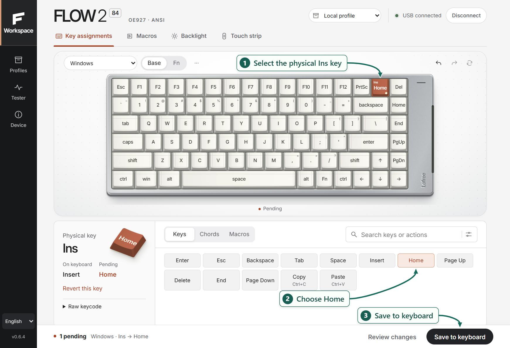
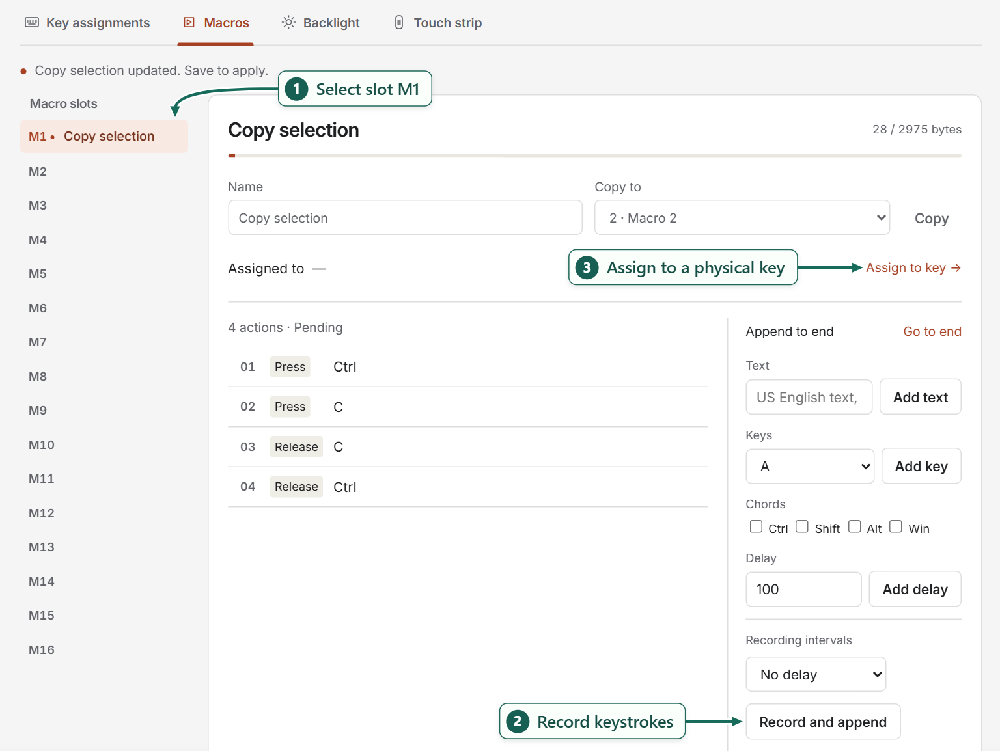
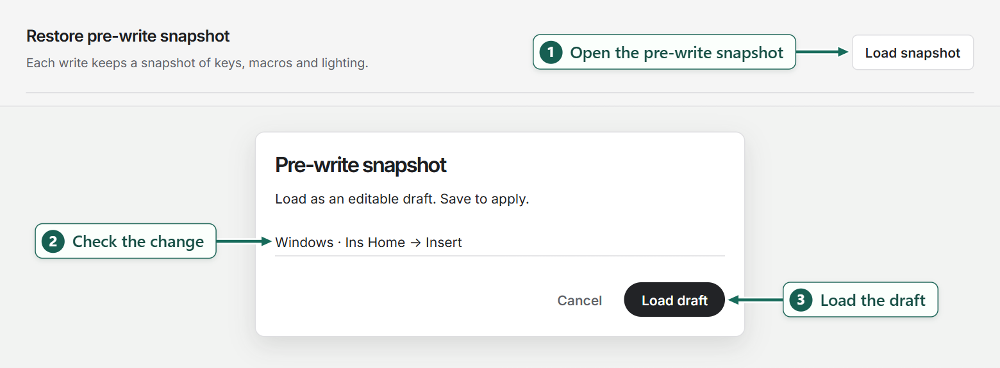

# FLOW2 Control

I rewrote the driver for my Lofree FLOW 2 simply because the official one sucks.

FLOW2 Control is an open-source web configurator for the **Lofree FLOW 2 84, standard ANSI edition (OE927)**. Plug it in over USB to remap keys, record macros and adjust the white backlight in desktop Chrome or Edge. The configurator reads back each change when you save. Your keymaps and macros stay on the keyboard and work over Bluetooth and 2.4 GHz.

**[Open the configurator](https://hyouo.github.io/flow2-control/)** · [中文](README.md) · [Releases](https://github.com/hyouo/flow2-control/releases)

## Configure a key

This example maps **Ins** to **Home** on the Windows base layer.

1. Switch the keyboard to wired mode, connect a USB data cable and use **Fn+N** to select Windows mode on the keyboard. Open the configurator, click **Configure via USB** and choose **Flow2@Lofree** in the browser prompt.
2. Open **Key assignments** and select **Windows → Base**. Click **Ins** at the top right of the keyboard diagram, then **Home** in the action list. The bottom bar shows the pending **Ins → Home** change.
3. Click **Save to keyboard**. Once readback is confirmed, click **Test this key** and press the physical **Ins** key. The tester should receive **Home**.



On your first visit, you can also open **Profiles → View navigation sample** to explore a profile without connecting a keyboard.

## Features and guides

- **Keymaps and macros.** Edit the base and Fn layers for Windows and macOS. Assign keys, shortcuts, media controls or macros to the 84 physical keys. Sixteen macro slots share 2,976 bytes. Record keystrokes or edit text, presses, releases and delays on the timeline.
- **Profiles and backups.** The keyboard stores one onboard configuration. Your browser keeps named profiles, macro names and unsaved drafts. Export a JSON file to move a profile to another computer. A device backup contains confirmed settings. A draft export includes pending edits.
- **Backlight and touch strip.** Choose from five white backlight levels with steady or breathing effects. Select the right edge of the keyboard diagram for the stock gestures, including swiping to change volume and holding Fn while swiping to adjust display brightness.
- **Key tester.** See the press and release events your browser receives and how many keys are held at once over USB, Bluetooth or 2.4 GHz.

<details>
<summary>Record Ctrl+C and assign it to a key</summary>

Open **Macros** and select an empty slot, such as M1. Click **Record and append**, press **Ctrl+C** in the recording area, then click **Stop recording**. The timeline shows the press and release of each key. Click **Assign to key →**, pick a key on the diagram, then click **Save to keyboard**. If you only changed the macro name, click **Save in this browser**.



</details>

<details>
<summary>Restore the configuration from before your last write</summary>

The configurator keeps a snapshot in your browser before each write. Open **Profiles** and click **Load snapshot** in the **Restore pre-write snapshot** row. To undo the remap above, look for **Home → Insert** in the preview. Click **Load draft**, then **Save to keyboard** to apply it. Resuming an interrupted write keeps the original restore point.



</details>

## Compatibility

The configurator talks to the stock firmware over WebHID using VIA 12. Tests on a standard OE927 confirmed that settings survive a power cycle and onboard macros play back over Bluetooth and 2.4 GHz. [Hardware results](HARDWARE-TEST.md)

| Environment | Test coverage |
| --- | --- |
| Windows · Chrome | On a physical OE927, the configurator read the keymap over USB, wrote the **Ins → Home** change, verified it by readback and restored the original configuration from a snapshot. |
| Windows · Edge | Tests with a simulated keyboard cover remapping, saving and reopening offline. USB writes to a physical keyboard still need testing. |
| macOS · Chromium | The browser suite runs in CI with a simulated keyboard. USB reads and writes on a physical Mac still need testing. |

Safari and Firefox can browse profiles, display the manual and run the key tester. After the first complete load, the site can reopen offline in the same browser. See the device notes for the layer matrix, macro capacity and stock firmware controls. [Device parameters](PARAMETERS.md) · [Lofree manual](https://cdn.shopify.com/s/files/1/2779/9046/files/Flow2_84_UserManual.pdf?v=1792140117)

## Local development

Local development requires Node.js 20 or later.

```sh
git clone https://github.com/hyouo/flow2-control.git
cd flow2-control
npm start
```

Open `http://127.0.0.1:8842/` in your browser. On Windows, you can also double-click `启动 FLOW2.vbs` in the repository. To build a static site for HTTPS hosting, run `npm run build` and deploy the contents of `dist/`.

Run `npm test` for the protocol, editor and local server tests. The browser suite uses a simulated keyboard and a local installation of Chrome.

```sh
npm ci
npm run test:browser
```

## Contributing

When reporting a bug, include your keyboard model, OS, browser, steps to reproduce, and expected and actual results. If you have a Mac and a standard OE927, try the remap and restore examples above. Report whether the write succeeded, what the physical key sent and whether the snapshot restored the original mapping. [Open an issue](https://github.com/hyouo/flow2-control/issues)

For device changes, start with the VIA transport and its protocol tests. For UI changes, the design notes describe the existing interactions. A screenshot in your pull request helps reviewers see the change. [VIA transport](public/via.js) · [Protocol tests](test/protocol.test.mjs) · [Design notes](DESIGN.md) · [CI](https://github.com/hyouo/flow2-control/actions/workflows/test.yml)

## License

The project code is distributed under the MIT License. The bundled Inter font uses the SIL Open Font License. The keyboard diagram uses the case dimensions and key layout from Lofree’s published OE927 materials. [MIT](LICENSE) · [Font license](public/fonts/OFL.txt) · [Product specifications](https://www.lofree.co/products/flow-2-84-low-profile-mechanical-keyboard)
