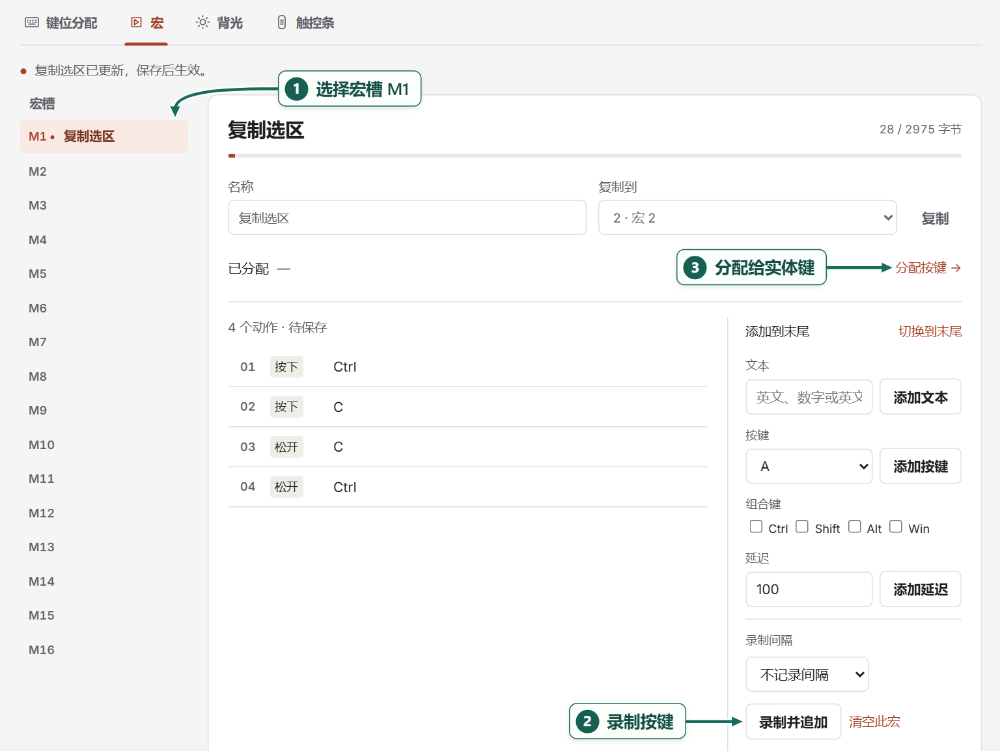
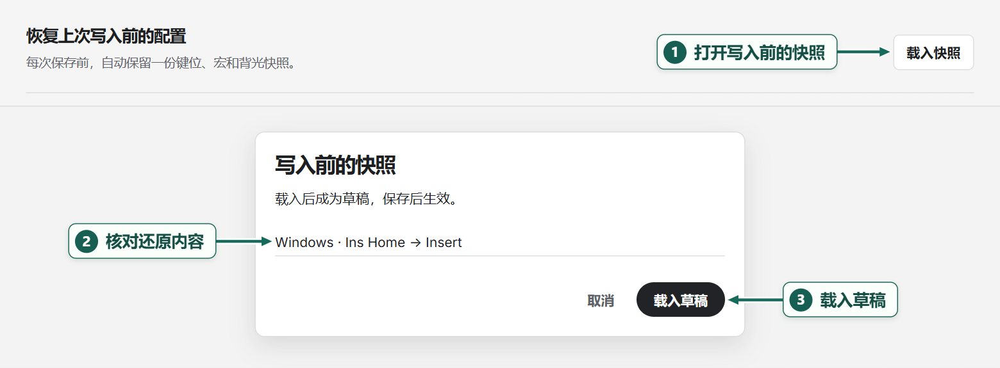

# FLOW2 Control

我给洛斐 FLOW 2 重写驱动，纯粹是因为官方驱动太烂了。

FLOW2 Control 是 **洛斐 FLOW 2 84 标准 ANSI 版（OE927）** 的开源网页配置器。用 USB 数据线连接键盘，就能在桌面 Chrome 或 Edge 里改键、录宏、调白色背光。保存时会从键盘读回设置并核对。拔掉线，改好的键位和宏在蓝牙和 2.4G 下也能用。

**[打开网页配置器](https://hyouo.github.io/flow2-control/)** · [下载静态网站 ZIP](https://github.com/hyouo/flow2-control/releases/latest/download/flow2-control-web.zip) · [发行说明](https://github.com/hyouo/flow2-control/releases) · [English](README.en.md)

## 使用

这个例子把 Windows 基础层的 `Ins` 改成 `Home`。

1. 把键盘切到有线档，接上 USB 数据线，用 `Fn+N` 切到 Windows 模式。打开配置器，点「通过 USB 配置」，在浏览器弹窗中选择 `Flow2@Lofree`。
2. 在「键位分配」中选 **Windows → 基础**。点键盘图右上角的 `Ins`，再从下方动作列表选 `Home`。此时底栏会显示待保存的 `Ins → Home`。
3. 点「保存到键盘」。看到读回确认后，点「测试此键」，按一下实体 `Ins`，检查页面是否收到 `Home`。


第一次打开时，也可以直接去「方案」点「查看导航键示例」，不接键盘就能预览内置方案。

## 功能与操作

- **键位与宏**　分别编辑 Windows、macOS 的基础层和 Fn 层。84 个实体键可分配普通按键、组合键、媒体动作或宏。16 个宏槽共享 2,976 字节，可录制按键，也可在时间轴上编辑文本、按下、松开和延迟。
- **方案与备份**　键盘保存一套配置。命名方案、宏名称和未保存的草稿留在当前浏览器。导出 JSON 可把方案带到另一台电脑。「导出备份」保存已从设备确认的配置，「导出当前草稿」包含正在编辑的改动。
- **背光与触控条**　白色背光有五档亮度，支持常亮和呼吸。点键盘图的右侧边缘，可以查看滑动调音量、按住 Fn 滑动调屏幕亮度等原厂手势。
- **按键测试**　测试页显示浏览器收到的按下、松开事件，以及同时按下的键数。USB、蓝牙和 2.4G 都能测试。

<details>
<summary>录一个 Ctrl+C 宏，分配给实体键</summary>

在「宏」页选一个空槽，例如 M1。点「录制并追加」，在录制区按下 `Ctrl+C`，再点「结束录制」。时间轴会列出 Ctrl 和 C 的按下与松开。点「分配按键 →」，在键盘图上选触发键，再点「保存到键盘」。只改宏名称时，点「保存到此浏览器」。



</details>

<details>
<summary>从快照恢复上一次写入前的配置</summary>

每次写入前，配置器都会在浏览器中保留快照。打开「方案」，在「恢复上次写入前的配置」一行点「载入快照」。要撤销上面的改键，预览里应当看到 `Home → Insert`。点「载入草稿」后，再点「保存到键盘」完成恢复。写入中断后重新连接并续写，仍会保留最初的恢复点。



</details>

## 兼容性与实测

配置器通过 WebHID 和 VIA 12 读写原厂固件。标准 OE927 实机已验证断电保存，以及蓝牙和 2.4G 下的板载宏触发。[实机记录](HARDWARE-TEST.md)

| 环境 | 已验证的范围 |
| --- | --- |
| Windows · Chrome | 真机 USB 读取、`Ins → Home` 写入与读回、从快照恢复完整配置。 |
| Windows · Edge | 用模拟键盘验证了改键和保存流程，以及离线重开。USB 实机写入待验证。 |
| macOS · Chromium | CI 用模拟键盘运行浏览器回归。Mac 真机 USB 读写待验证。 |

Safari 和 Firefox 可查看方案、查阅手册和测试按键。网页版首次完整加载后，可在同一浏览器离线重开。各层矩阵、宏容量和固件可调参数见设备说明。[设备参数](PARAMETERS.md) · [洛斐官方手册](https://cdn.shopify.com/s/files/1/2779/9046/files/Flow2_84_UserManual.pdf?v=1792140117)

## 常见问题

- **能打字，连接窗口里却没有键盘。** 把标准版 OE927 切到有线档，用 USB 数据线直接连接电脑，在桌面 Chrome 或 Edge 中打开配置器。蓝牙和 2.4G 可以打字，修改配置需要 USB。若已选到键盘但读取超时，先关闭同时连接它的其他配置页面，再重连。
- **保存后仍发出原来的键。** 在编辑器核对改动所在的系统层和基础／Fn 层。实体键盘用 `Fn+N` 切 Windows，`Fn+M` 切 Mac。测试 Fn 层时，按住 Fn 再按对应的键。
- **导入 JSON 时提示选择本工具导出的备份。** 原厂 VIA 布局文件用来绘制键盘。要迁移自己的设置，请在原来的浏览器打开「方案」，从「导出完整配置」或「导出当前草稿」取得文件，再在新浏览器点「选择文件」。

## 自行托管

解压 `flow2-control-web.zip`，把包含 `index.html` 的目录发布到 HTTPS 站点，域名根目录和子目录都可以。要在本机打开，可在解压目录用 Python 3 运行下面的命令，再用 Chrome 或 Edge 访问 `http://127.0.0.1:8000/`。在 macOS 上，Python 命令通常是 `python3`。

```sh
python -m http.server 8000 --bind 127.0.0.1
```

## 本地开发

本地运行需要 Node.js 20 或更新版本。

```sh
git clone https://github.com/hyouo/flow2-control.git
cd flow2-control
npm start
```

在浏览器打开 `http://127.0.0.1:8842/`。Windows 用户也可以双击仓库里的 `启动 FLOW2.vbs`。运行 `npm run build` 可在 `dist/` 生成可部署到 HTTPS 站点的静态文件。

`npm test` 运行协议、编辑器和本地服务测试。浏览器回归使用模拟键盘和本机安装的 Chrome，可用下面两条命令运行。

```sh
npm ci
npm run test:browser
```

## 参与项目

在配置器的「设备」页点「反馈问题或实测」，表单会带上正在使用的配置器版本。请写下型号、操作系统、浏览器、连接方式和实际结果。「设备 → 连接记录」里有可供引用的错误信息。[填写设备反馈](https://github.com/hyouo/flow2-control/issues/new?template=device-report.yml) · [已有 Issues](https://github.com/hyouo/flow2-control/issues)

欢迎补充 Mac 和 Windows Edge 的实测结果。Mac 上请用 `Fn+M` 切到 Mac 模式，在编辑器选「macOS → 基础」。Windows Edge 可沿用上面的 Windows 示例。先记下原映射，再分别记录写入后的读回值、实体键发出的事件，以及恢复后是否与原值一致。

修改设备读写可以从 VIA 通信实现和协议测试入手。修改界面可以参考现有的交互设计，在 PR 中附上操作截图。[VIA 通信](public/via.js) · [协议测试](test/protocol.test.mjs) · [界面设计](DESIGN.md) · [CI](https://github.com/hyouo/flow2-control/actions/workflows/test.yml)

## 许可

项目自有代码采用 MIT 许可，随附的 Inter 字体采用 SIL Open Font License。[MIT](LICENSE) · [字体许可](public/fonts/OFL.txt)

键盘图的尺寸参考洛斐产品规格。矩阵位置和键宽取自洛斐的 `Flow2_84_OE927_ANSI-US_VIA.json`，静态网站从这份定义中提取 `layouts`。[仓库中的布局定义](flow2-84.official.json) · [洛斐下载中心](https://www.lofree.co/pages/download-center) · [产品规格](https://www.lofree.co/products/flow-2-84-low-profile-mechanical-keyboard)
