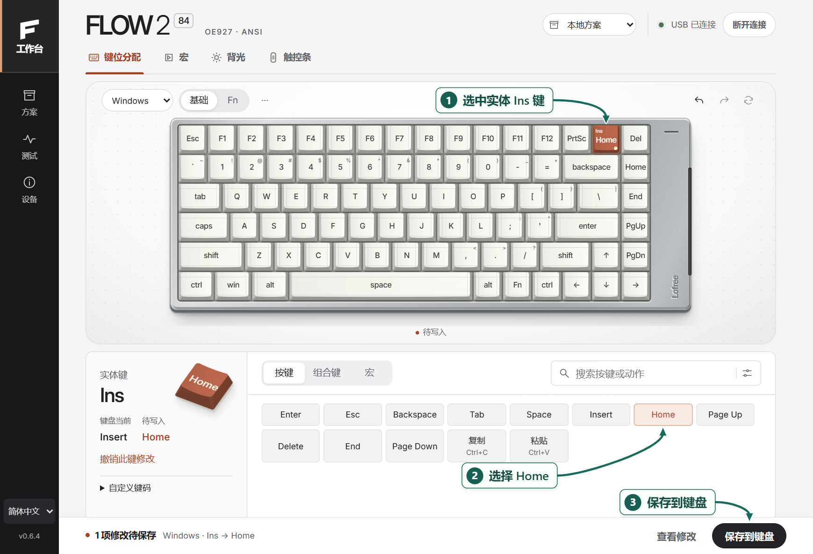

# FLOW2 Control

用浏览器给**洛斐 FLOW 2 84** 改键、录制快捷键、调节背光。支持标准美式布局（ANSI），型号 **OE927**。改好的键位存在键盘里，拔掉线换回蓝牙或 2.4G 也能用。

**[用桌面 Chrome 或 Edge 打开配置器](https://hyouo.github.io/flow2-control/)** · [English](README.en.md)

## 使用

把键盘切到有线档，用 USB 数据线连上电脑。打开配置器，点右上角的「通过 USB 配置」，在弹窗里选 `Flow2@Lofree`。

试着把 `Ins` 改成 `Home`。这样在 Windows 记事本里按一下 `Ins`，光标就会回到行首。

1. **点要改的键。** 在键盘上按 `Fn+N` 切到 Windows 模式。网页选「Windows → 基础」，点键盘图右上角、`Del` 左边的 `Ins`。
2. **选它的新用途。** 在键盘图下方的「按键」列表中点 `Home`。
3. **点「保存到键盘」。** 保存后点「测试此键」，按一下实体 `Ins`。页面显示 `Home` 就改好了。

[把 Ctrl+C 绑到一个键（图解）](docs/guide.md#一键复制) · [把刚改的键恢复原样（图解）](docs/guide.md#恢复改键) · [调背光和查看触控条手势](docs/guide.md#背光和触控条)

## 常见问题

**能打字，但网页找不到键盘。** 把键盘从无线档切到有线档，确认 USB 线能传数据，再点「通过 USB 配置」。[其他连接、改键和备份问题](docs/guide.md#使用中遇到问题)

**在 Mac 上改键。** 键盘按 `Fn+M`，网页选「macOS → 基础」。Windows 上的 Chrome 已用真机验证过改键和恢复。Mac 和 Windows 上的 Edge 还缺真机读写记录。[实测记录](HARDWARE-TEST.md)

## 关于项目

我给洛斐 FLOW 2 重写驱动，纯粹是因为官方驱动太烂了。

遇到问题可以在配置器的「设备」页点「反馈问题或实测」，表单会自动带上版本号。[提交反馈](https://github.com/hyouo/flow2-control/issues/new?template=device-report.yml)

[下载网页版 ZIP](https://github.com/hyouo/flow2-control/releases/latest/download/flow2-control-web.zip) · [在本机打开 ZIP](docs/guide.md#使用下载的网页版) · [从源码运行](docs/guide.md#从源码运行) · [MIT 许可](LICENSE)
