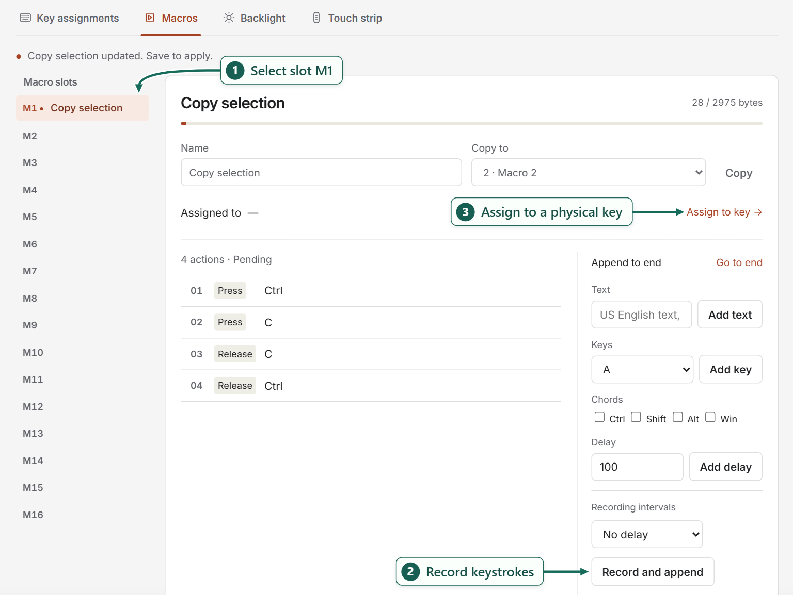
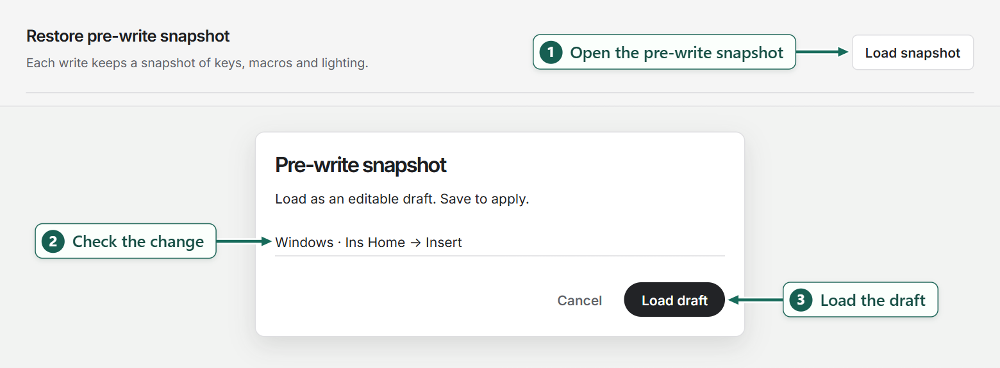

# FLOW2 Control guide

[Open the configurator](https://hyouo.github.io/flow2-control/) · [Remap your first key](../README.en.md#configure-a-key) · [中文](guide.md)

## Copy with one key

For a copy shortcut, select a key under **Key assignments**, choose **Copy** and click **Save to keyboard**.

To play back a sequence with one key, record it as a **macro**. The example below uses **Ctrl+C** on Windows to show how recording works.

1. Open **Macros**, select an empty slot such as M1 and click **Record and append**.
2. Press and release **Ctrl+C** in the recording area, then click **Stop recording**. The timeline shows each key press and release.
3. Click **Assign to key →**, choose the key that will run the macro, then click **Save to keyboard**.



## Restore a key

Before each write, the configurator keeps a copy of the previous settings in your browser. This copy is called a snapshot. To undo the remap from the README, follow these steps.

1. Open **Profiles**. In the **Restore pre-write snapshot** row, click **Load snapshot**.
2. Look for **Home → Insert** in the preview. It shows that the key will regain its original action.
3. Click **Load draft**, then **Save to keyboard**. The physical **Ins** key will send Insert again.



## Backlight and touch strip

Open **Backlight**, choose a brightness level and a steady or breathing effect, then click **Save to keyboard**. Click the right edge of the keyboard diagram for the touch strip guide. Swipe to change volume, hold Fn while swiping to adjust display brightness, or hold **Fn+Space** for about three seconds to turn the strip on or off.

## Keep a profile or move it to another computer

The keyboard stores one active configuration. Your browser keeps your other named profiles, macro names and unfinished edits. On your first visit to **Profiles**, click **View navigation sample** to explore a profile without a keyboard.

To move saved settings, open **Profiles** and click **Export backup**. To include pending edits, use **Export profile** in the **Export draft** row. Connect the keyboard on the other computer, click **Choose file**, review the changes and save them to the keyboard.

## Troubleshooting

- **Selecting the keyboard works, but reading it times out.** Close any other configurator using the keyboard and reconnect.
- **The remap saved, but the key still sends its old action.** Check the system selected in the app. Match it on the keyboard with **Fn+N** for Windows or **Fn+M** for Mac. **Base** sets what happens when you press the key on its own. **Fn** sets what happens while you hold Fn.
- **Import asks for a FLOW2 Control backup.** Lofree’s VIA layout file describes the positions and widths of the keys. To move your settings, use a file exported from **Profiles** in FLOW2 Control.

Hardware tests used a standard US ANSI OE927 with stock firmware. Safari and Firefox can display profiles and run the key tester. For USB configuration, use desktop Chrome or Edge. If you file a report, you can copy the relevant messages from **Device → Connection log**. [Device report](https://github.com/hyouo/flow2-control/issues/new?template=device-report.yml) · [Hardware results](../HARDWARE-TEST.md)

Hardware reports from Mac users and Windows Edge users are welcome. Note the original assignment, what the app shows after saving, what the physical key sends and whether restoring the snapshot brings back the original assignment.

## Run the downloaded site

Download and unzip `flow2-control-web.zip`. Serve the directory containing `index.html` on an HTTPS site, or run it locally. With Python 3 installed, run the command below from the extracted directory and open `http://127.0.0.1:8000/`. On macOS the Python command is usually `python3`. [Download ZIP](https://github.com/hyouo/flow2-control/releases/latest/download/flow2-control-web.zip) · [Release notes](https://github.com/hyouo/flow2-control/releases)

```sh
python -m http.server 8000 --bind 127.0.0.1
```

After the first complete load, the site can reopen offline in the same browser.

## Run from source

Use Node.js 20 or later.

```sh
git clone https://github.com/hyouo/flow2-control.git
cd flow2-control
npm start
```

Open `http://127.0.0.1:8842/`. On Windows you can also double-click `启动 FLOW2.vbs` in the repository. Run `npm test` for the unit tests, or `npm run build` to produce the static site in `dist/`.

The browser suite uses an installed copy of Chrome and a simulated keyboard.

```sh
npm ci
npm run test:browser
```

For changes to device reads and writes, start with the VIA transport and its protocol tests. The design notes describe how the interface works. [Device notes](../PARAMETERS.md) · [VIA transport](../public/via.js) · [Protocol tests](../test/protocol.test.mjs) · [Design notes](../DESIGN.md) · [CI](https://github.com/hyouo/flow2-control/actions/workflows/test.yml)

The diagram uses Lofree’s case dimensions and the key positions and widths from `Flow2_84_OE927_ANSI-US_VIA.json`. The project code uses the MIT License. The bundled Inter font uses the SIL Open Font License. [Product specifications](https://www.lofree.co/products/flow-2-84-low-profile-mechanical-keyboard) · [Layout file](../flow2-84.official.json) · [Lofree Download Center](https://www.lofree.co/pages/download-center) · [MIT](../LICENSE) · [Font license](../public/fonts/OFL.txt)
