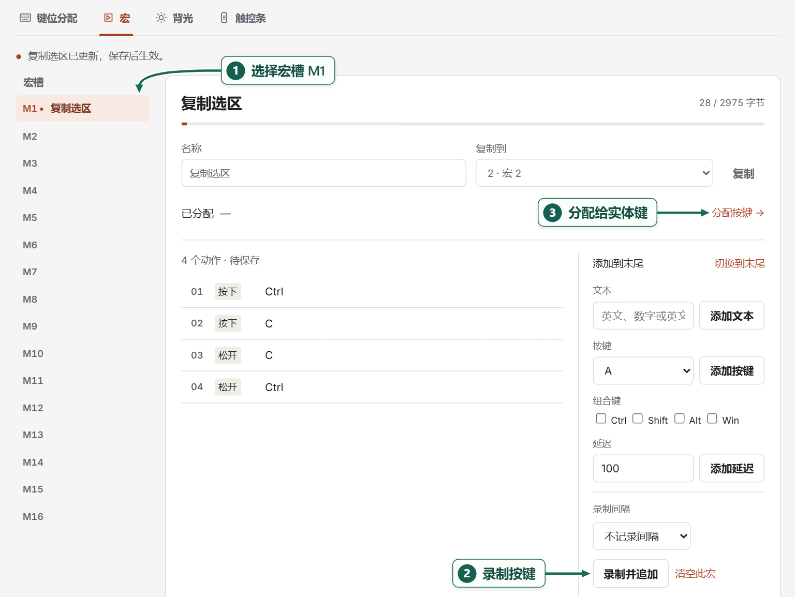
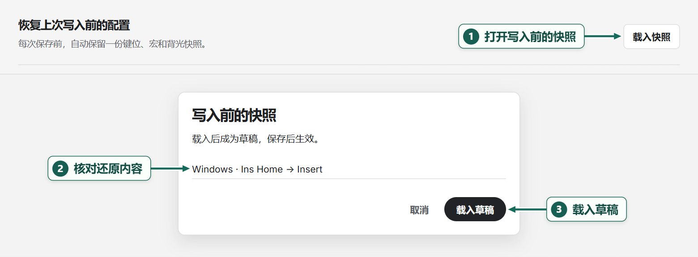

# FLOW2 Control 使用指南

[打开配置器](https://hyouo.github.io/flow2-control/) · [第一次改键](../README.md#使用) · [English](guide.en.md)

## 一键复制

只想按一下键就复制文字，可以在「键位分配」里点一个键，选择「复制」，再点「保存到键盘」。

要让一个键重放一串操作，可以把这些按键录成一个**宏**。图中用 Windows 的 `Ctrl+C` 演示录制过程。

1. 打开「宏」，选一个空位，例如 M1，点「录制并追加」。
2. 在录制区按下并松开 `Ctrl+C`，再点「结束录制」。列表会显示刚才按下和松开的键。
3. 点「分配按键 →」，在键盘图上选一个用来执行它的键，再点「保存到键盘」。



## 恢复改键

每次写入前，配置器都会在当前浏览器留一份原设置，叫作「快照」。要撤销首页示例里的改键，可以这样做。

1. 打开「方案」，在「恢复上次写入前的配置」一行点「载入快照」。
2. 在预览里找到 `Home → Insert`，确认这个键会改回原来的用途。
3. 点「载入草稿」，再点「保存到键盘」。这时再按 `Ins`，就会恢复原来 Insert 的作用。



## 背光和触控条

在「背光」页选亮度、常亮或呼吸效果，点「保存到键盘」。要看右侧触控条的用法，点键盘图的右边缘。上下滑动调音量，按住 Fn 滑动调屏幕亮度，长按 `Fn+空格` 约三秒可开关触控条。

## 保存方案和换电脑

键盘保留当前使用的一套设置。其他命名方案、宏名称和未保存的草稿放在浏览器里。第一次打开「方案」时，可以点「查看导航键示例」，不接键盘也能预览。

要带走已保存的设置，在「方案」点「导出备份」。要连还没保存的修改一起带走，在「导出当前草稿」一行点「导出方案」。在另一台电脑接好键盘，点「选择文件」，核对改动后再保存到键盘。

## 使用中遇到问题

- **选到键盘，但一直读取超时。** 关闭其他正在使用这把键盘的配置页面，再重新连接。
- **保存成功，按键还是原来的作用。** 看网页上选的是 Windows 还是 macOS，并用 `Fn+N` 或 `Fn+M` 让实体键盘切到对应模式。「基础」是直接按键的作用，「Fn」是按住 Fn 时的作用。
- **导入 JSON 时提示选择本工具的备份。** 洛斐的 VIA 布局文件记录键的位置和宽度。迁移个人设置请使用 FLOW2 Control 在「方案」页导出的文件。

硬件实测使用标准美式布局 OE927 的原厂固件。Safari 和 Firefox 可以查看方案和测试按键。写入键盘请用桌面 Chrome 或 Edge。报告问题时，可以从「设备 → 连接记录」复制相关消息。[设备反馈](https://github.com/hyouo/flow2-control/issues/new?template=device-report.yml) · [硬件实测](../HARDWARE-TEST.md)

欢迎补充 Mac 和 Windows Edge 的实测结果。改键前记下原来的用途，保存后记录网页显示什么、按实体键时收到什么，以及从快照恢复后是否回到原值。

## 使用下载的网页版

下载并解压 `flow2-control-web.zip`。可以把含有 `index.html` 的目录发布到 HTTPS 网站，也可以在本机打开。装有 Python 3 时，在解压目录运行下面的命令，再访问 `http://127.0.0.1:8000/`。macOS 上的命令通常是 `python3`。[下载 ZIP](https://github.com/hyouo/flow2-control/releases/latest/download/flow2-control-web.zip) · [发行说明](https://github.com/hyouo/flow2-control/releases)

```sh
python -m http.server 8000 --bind 127.0.0.1
```

网页首次完整加载后，用同一浏览器可以离线重开。

## 从源码运行

需要 Node.js 20 或更新版本。

```sh
git clone https://github.com/hyouo/flow2-control.git
cd flow2-control
npm start
```

打开 `http://127.0.0.1:8842/`。在 Windows 上也可以双击仓库里的 `启动 FLOW2.vbs`。运行 `npm test` 执行单元测试，运行 `npm run build` 在 `dist/` 生成静态网站。

浏览器测试使用本机安装的 Chrome 和模拟键盘。

```sh
npm ci
npm run test:browser
```

修改键盘读写时，可从 VIA 通信实现和对应的协议测试入手。界面改动可参考现有的交互设计。[设备参数](../PARAMETERS.md) · [VIA 通信](../public/via.js) · [协议测试](../test/protocol.test.mjs) · [界面设计](../DESIGN.md) · [CI](https://github.com/hyouo/flow2-control/actions/workflows/test.yml)

键盘图的机身尺寸参考洛斐产品规格，键位和键宽来自洛斐的 `Flow2_84_OE927_ANSI-US_VIA.json`。项目自有代码采用 MIT 许可，随附的 Inter 字体采用 SIL Open Font License。[产品规格](https://www.lofree.co/products/flow-2-84-low-profile-mechanical-keyboard) · [布局文件](../flow2-84.official.json) · [洛斐下载中心](https://www.lofree.co/pages/download-center) · [MIT](../LICENSE) · [字体许可](../public/fonts/OFL.txt)
